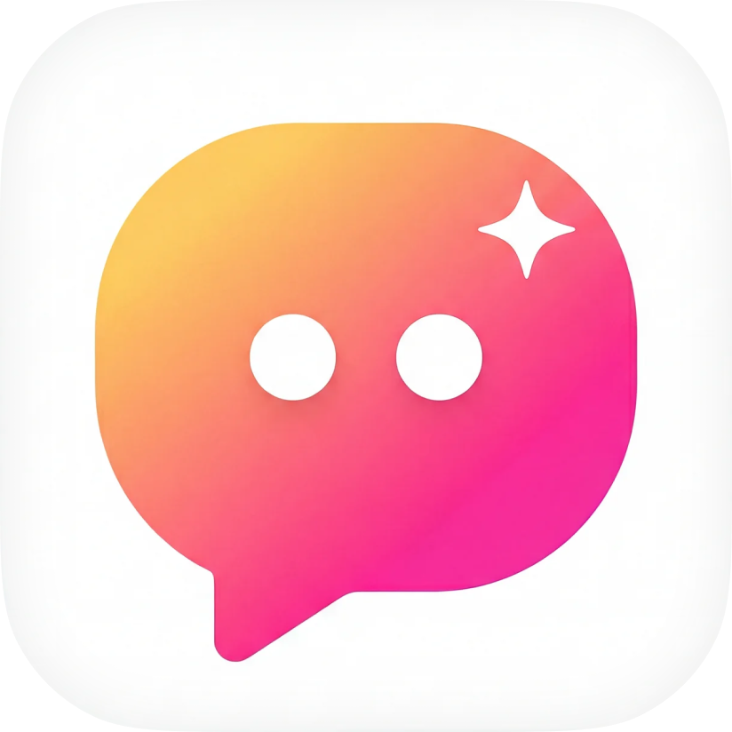
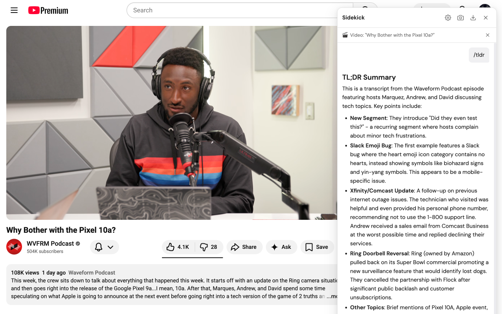
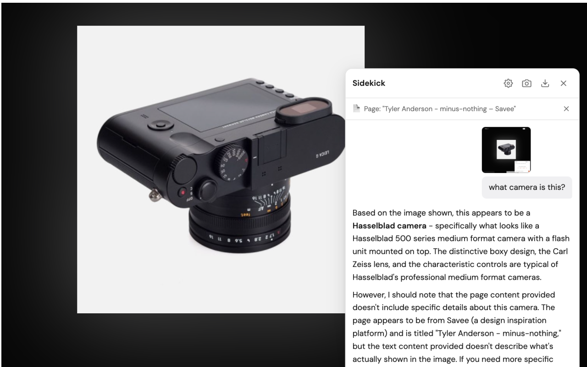
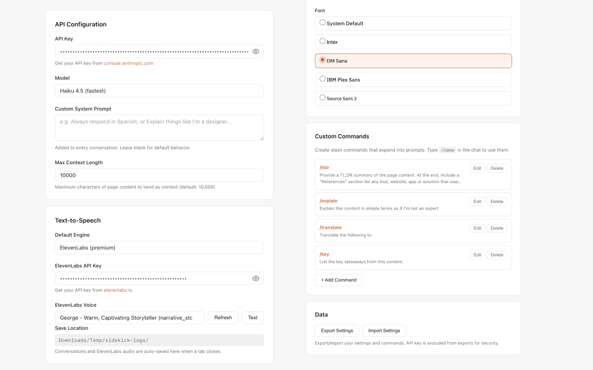

<p></p>

<h1>Sidekick</h1>

<p>Chat with AI about the page you're reading.<br>
A private floating chat. Not an AI browser, not a sidebar. Bring your own API key.</p>

<p>
  
  
  
  
</p>

<p>
  <a href="https://chromewebstore.google.com/detail/sidekick/bniahajjmpkajkpeelflghnaapjgmcbn"></a>
</p>

https://github.com/user-attachments/assets/7db58286-4408-4089-ad71-3491e354b1b4

Most AI browser integrations prioritize convenience over privacy. Some AI Chrome extensions are decent, but they usually just are sidebar chats. My use cases are simple: I'm reading something or watching a video, and I want to act on that content, either save it, summarize it, or run it through different commands/prompts. It doesn't need to proactively take screenshots of what I'm doing or read my content. I built Sidekick with all of this in mind.

It works as a floating chat that imports the content of the tab when it was triggered at the moment you send your first message but you can clear that context if it's irrelevant for your message. It also is able to take screenshots of the active tab if you need the context to be visual. You can import local files as well. Every conversation is optionally saved locally so summaries or specific workflows are never lost. You can even use your ElevenLabs API key if you want to listen to the answers instead of reading them, which is useful if what you want is to "listen to articles" like you do with services like Speechify.

The real strength comes with your custom commands, which are shortcuts for reusable prompts.

Sidekick is not for people who want an autonomous browsing agent. It's for those who want to power up their browsing experience without sacrificing privacy.

## Install

Install from the [Chrome Web Store](https://chromewebstore.google.com/detail/sidekick/bniahajjmpkajkpeelflghnaapjgmcbn), or load it from source:

1. Clone or download this repository
2. Open `chrome://extensions` (or `brave://extensions` in Brave)
3. Turn on **Developer mode** (top right)
4. Click **Load unpacked** and select the project folder
5. Click the Sidekick icon on any page, then the gear icon to pick a provider and add your API key

To open Sidekick with a keyboard shortcut, assign one at `chrome://extensions/shortcuts`.

## Features

**Page and video context.** Sidekick reads the current page, or the full YouTube transcript with timestamps, when you send your first message. The context bar lets you discard it first, and on YouTube you can download the transcript.

<p align="center">
  
</p>

**Slash commands.** Built in: `/tldr` (summary plus a "worth your time" verdict), `/podcast` (read-aloud version), `/questions` (top-five FAQ), `/contrarian` (strongest fair objections), and `/research` (checks the page against the web). Add text to refine one, like `/tldr 3 bullet points`. Edit them or create your own in Settings, and optionally run one automatically when you open an empty chat.

**Listen.** The speaker in the header reads the article or transcript aloud, and **Speak** reads any reply. With ElevenLabs, sound starts in about a second while the rest generates. A player strip shows the time and has seek, speed (1x to 2.5x), MP3 download, and close. Free browser voices and a local Kokoro server also work.

**Screenshots and images.** The camera button captures the visible page; you can also drop in images or text files. Works with Claude, OpenAI, vision models on Fal.ai, and Gemma 4 in LM Studio.

<p align="center">
  
</p>

**Web search.** With a Fal.ai key, Claude, GPT-5, and Gemini 3 models can search the live web. It's on by default when a Fal key is set; models that can't search are hidden while it's on.

**Also:** streaming replies with a Stop that always works, memory (type "remember ..."), custom system prompt, optional auto-save of chats and audio, glass or classic style, dark mode, font choice, a floating button, resizable window, settings export/import, and a separate conversation per tab.

## Settings

Open Settings from the gear icon. Changes save as you go:

- **Provider:** Anthropic (Claude), OpenAI, Fal.ai (OpenRouter), Google Gemini, DeepSeek, or Local (LM Studio), each with its own key and model. The chat header's model picker shows the newest few models per main lab; Settings lists them all.
- **Voice:** ElevenLabs (key, voice, and Flash v2.5 or Multilingual v2), Kokoro, or browser voices, plus auto-download of generated MP3s to a folder in Downloads.
- **Look:** chat style, theme, font, and the floating button.
- **Commands:** add, edit, delete, and pin commands to the empty chat.
- **Data:** export or import settings, commands, and memory. API keys are never exported.

<p align="center">
  
</p>

## Privacy

There is no Sidekick server, account, analytics, or tracking. Keys, conversations, memory, and settings stay in your browser's local storage.

- Page content and messages go straight from your browser to the provider you chose, and only when you send a message, press Listen or Speak, or have auto-submit on.
- ElevenLabs gets text only when you listen with an ElevenLabs voice. Local model and Kokoro requests stay on `localhost`.
- The default system font makes no network request. DM Sans, IBM Plex Sans, and Source Sans 3 load from Google Fonts if you pick them.

Full policy: [privacy.html](https://madebysan.github.io/sidekick/privacy.html)

## Requirements

- Chrome, Brave, or another Chromium browser
- An API key for [Anthropic](https://console.anthropic.com/settings/keys), [OpenAI](https://platform.openai.com/api-keys), [Google Gemini](https://aistudio.google.com/apikey), [DeepSeek](https://platform.deepseek.com/api_keys), or [Fal.ai](https://fal.ai/dashboard/keys), or LM Studio running a local model
- Optional: an [ElevenLabs](https://elevenlabs.io) key for natural voices

## Known limitations

- Page extraction is heuristic, so unusual or heavily client-rendered sites may give partial context. Raise **Max Context** (60,000 characters by default) for long pages.
- While a long ElevenLabs listen is still generating, you can seek only within the audio made so far.
- If a Fal, Gemini, or OpenAI stream sends nothing for two minutes, Sidekick stops waiting and shows an error.

## Tech stack

Manifest V3, vanilla JavaScript, no build step, no npm dependencies. The UI lives in a closed Shadow DOM so pages can't restyle or read it. [Readability.js](https://github.com/mozilla/readability) (Apache 2.0, in `vendor/`) extracts articles for listening.

## Development

There is no build step. Load the folder unpacked (see [Install](#install)), edit, then click **Reload** on the Sidekick card in `chrome://extensions` and refresh the page you're testing.

Run the provider adapter check after touching `chat.js`, `providers.js`, or `prompts.js`:

```bash
node scripts/test-provider-adapters.mjs
```

## Feedback

Found a bug or have a feature idea? [Open an issue](https://github.com/madebysan/sidekick/issues).

## License

[MIT](LICENSE)

---

Made by [santiagoalonso.com](https://santiagoalonso.com)
